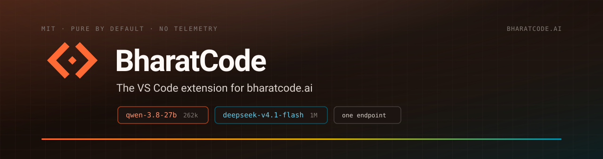

<div align="center">

<picture>
  <source media="(max-width: 640px)" srcset="docs/assets/hero-mobile.svg">
  
</picture>

<br>

<a href="https://marketplace.visualstudio.com/items?itemName=thenabbu.bharatcode-vscode"></a>
<a href="https://github.com/thenabbu/BharatCode-VSCode-Extension/releases/latest"></a>
<a href="https://github.com/thenabbu/BharatCode-VSCode-Extension/actions/workflows/checks.yml"></a>
<a href="LICENSE"></a>
<a href="https://bharatcode.ai"></a>

<br>

### Your coding agent, ready in one click

**BharatCode for VS Code** installs the whole agent for you — runtime, provider, endpoint and models included. Sign in, and you are writing with it.

</div>

---

**[Install from the VS Code Marketplace »](https://marketplace.visualstudio.com/items?itemName=thenabbu.bharatcode-vscode)**

*Or press `Ctrl+P` / `⌘P` and paste:*

```bash
ext install thenabbu.bharatcode-vscode
```

VS Code **1.105.1** or newer. Chromebook, Linux, macOS and Windows all get their own build.

---

## Three steps to your first task

**1. Click install.** The Marketplace link above does everything — VS Code downloads it and adds the agent to your editor. Around 160–180 MB, because the entire runtime travels inside the package. Nothing to fetch afterwards.

**2. Open a folder.** `File → Open Folder`. Your project is what the agent reads and edits.

**3. Sign in.** BharatCode greets you on first launch and offers both ways in:

| | **Sign in with BharatCode** | **API key** |
|---|---|---|
| **Best for** | Nearly everyone | Scripts, shared machines, CI |
| **How** | A browser tab opens; click approve; done | Paste a key from your bharatcode.ai account |
| **Typing** | None | One paste |

Both are first-class paths and both work on first run — pick either. Your credential is stored by the extension backend, **never** in `settings.json`, so it stays out of your repo and your dotfiles.

Missed the prompt? `BharatCode: Connect Account` in the Command Palette brings it back.

That is the entire setup. No base URL, no provider JSON, no model list, no CLI.

---

## What it does

**Writes across your project.** Describe the change; it edits the files, shows you a diff, and you approve what lands.

**Switches hats with you.** *Code* implements, *Plan* designs before writing, *Ask* answers from your codebase, *Debug* traces a failure to its cause. Custom agents are plain-text definitions you can write yourself.

**Runs several tasks at once.** Agent Manager puts sessions side by side, each in its own git worktree, so parallel work stays out of its own way.

**Runs what it wrote.** It has the terminal and a browser, so it can execute the build, read the error, and fix it before handing back.

**Checks its own work.** It re-reads what it produced and corrects before you see it.

**Learns your project.** MCP servers, skills and rules live in plain text and can be scoped per project.

**Handles the small stuff.** Commit messages written from your staged diff, plus inline actions on any selection: explain, fix, improve, add to context.

---

## The models

Your BharatCode account comes with two models, and the extension wires both up for you. Switch mid-task from the picker in the chat header.

| Model | Context | Best at |
|---|---|---|
| `qwen-3.8-27b` | 262k | Everyday edits and fast iteration |
| `deepseek-v4.1-flash` | 1M | Whole-repo reasoning and long sessions |

Both come from one OpenAI-compatible endpoint at `https://bharatcode.ai/api/model/v1`, and the list is read live from it.

**Prefer another model?** Add it yourself. Settings → Providers → **Custom provider** takes a base URL, a key and a model list, and supports OpenAI, OpenAI-compatible and Anthropic endpoints. Bring your own key for OpenAI, Anthropic, or anything else you run, and it sits alongside the BharatCode models you already have.

---

## Configuration

Two layers, kept separate on purpose:

- **VS Code settings** (`kilo-code.*`) — editor-side: language, font size, notifications, default model, auto-approve. 35 of them, all documented inline in the Settings UI.
- **Agent config** (`kilo.json`) — project-level, or global at `~/.config/kilo/`. Model, permissions, instructions, MCP servers, custom agents.

The `kilo-code.*` prefix and `.kilo` path are the backend's identifiers — renaming them would break keybindings and existing config, so the ids stay and only the labels say BharatCode.

Every setting, config key and failure case: **[docs/CONFIGURATION.md](docs/CONFIGURATION.md)**.

---

## Install by hand

<details>
<summary>Download a <code>.vsix</code> for your platform</summary>

<br>

Grab the file for your system from [Releases](https://github.com/thenabbu/BharatCode-VSCode-Extension/releases/latest), then run `Extensions: Install from VSIX...` from the Command Palette:

```bash
code --install-extension bharatcode-vscode-linux-x64-<version>.vsix
```

Eight platform builds ship per release, plus `SHA256SUMS`:

| Platform | File suffix | | Platform | File suffix |
|---|---|---|---|---|
| Linux x64 | `linux-x64` | | Linux arm64 | `linux-arm64` |
| Alpine x64 | `alpine-x64` | | Alpine arm64 | `alpine-arm64` |
| macOS Intel | `darwin-x64` | | macOS Apple Silicon | `darwin-arm64` |
| Windows x64 | `win32-x64` | | Windows arm64 | `win32-arm64` |

Each carries its own runtime binary, which is why they are split per platform — you download yours, once. Verify with `sha256sum --check SHA256SUMS`.

> **macOS first run:** builds are unsigned for now. If Gatekeeper blocks it:
> `xattr -dr com.apple.quarantine ~/.vscode/extensions/bharatcode.bharatcode-vscode-*`

</details>

---

## FAQ

<details>
<summary>Is BharatCode the same thing as this extension?</summary>

Two separate things, and the split is what makes setup simple.

**BharatCode** ([bharatcode.ai](https://bharatcode.ai)) is an LLM inference provider — one OpenAI-compatible endpoint, one key, two chat models. It serves models. It is your account.

**This extension** is the VS Code client for that provider. It ships the agent runtime inside the package and points it at your BharatCode account, which is why signing in is the only step you take.

Install the extension, sign in, and the agent is running — because the extension does the wiring.

</details>

<details>
<summary>Where does this extension come from?</summary>

It is a fork of [Kilo Code](https://github.com/Kilo-Org/kilocode), itself a fork of [OpenCode](https://github.com/anomalyco/opencode). Those projects and their contributors built the agent this package runs, and the credit is theirs — MIT licensed, with attribution preserved in [LICENSE](LICENSE) and in the `kilocode_change` markers throughout the source. This fork brings that agent to the BharatCode provider, rebrands it, and reconfigures the provider layer so bharatcode.ai is wired in from the start. We build on their work; we do not claim it.

</details>

<details>
<summary>Do I need a key if I sign in with my browser?</summary>

One or the other is enough. Browser sign-in stores a session; a pasted key stores a key. Both land in the extension backend's auth store and both go only to the provider you connected.

</details>

<details>
<summary>Why two models instead of a big catalogue?</summary>

Because that is what your BharatCode account serves, and they cover a lot of ground between them: 262k context for fast day-to-day work, 1M for whole-repo reasoning. If you want more, add your own provider under **Custom provider** and your own models show up next to these.

</details>

<details>
<summary>How do I sign out, or switch accounts?</summary>

**Settings → Providers → the BharatCode card → disconnect**. That clears the stored credential, so a stale login cannot quietly reconnect. Uninstalling keeps the credential files, so a reinstall resumes your session — for a clean slate, quit VS Code fully and delete `~/.local/share/kilo/` (`%USERPROFILE%\.local\share\kilo\` on Windows).

</details>

<details>
<summary>Does it work offline?</summary>

The agent runtime lives on your machine, so it starts without a network. The models are served remotely, so plan on a connection for actual work.

</details>

---

## Where to look next

| If you want to… | Read |
|---|---|
| Change a setting or pick a model | [docs/CONFIGURATION.md](docs/CONFIGURATION.md) |
| Know exactly what leaves your machine | [PRIVACY.md](PRIVACY.md) |
| Contribute code or docs | [CONTRIBUTING.md](CONTRIBUTING.md) |
| Work on the codebase | [AGENTS.md](AGENTS.md) |
| Cut a release | [RELEASING.md](RELEASING.md) |
| Report a vulnerability | [SECURITY.md](SECURITY.md) |

## Contributing

Pull requests are welcome from developers and writers alike. Start with [CONTRIBUTING.md](CONTRIBUTING.md); if you are touching code, read [AGENTS.md](AGENTS.md) — it is the same file the agent itself follows. The [Code of Conduct](CODE_OF_CONDUCT.md) applies to every space around this project.

## License

MIT — use it, modify it, ship it commercially, keeping the attribution and licence notices. Full text, including upstream copyright lines, in [LICENSE](LICENSE).

<div align="center">
<br>
<sub><a href="https://bharatcode.ai">bharatcode.ai</a> · <a href="https://marketplace.visualstudio.com/items?itemName=thenabbu.bharatcode-vscode">Marketplace</a> · <a href="https://github.com/thenabbu/BharatCode-VSCode-Extension/releases/latest">Releases</a> · <a href="https://github.com/thenabbu/BharatCode-VSCode-Extension/issues">Issues</a></sub>
</div>
