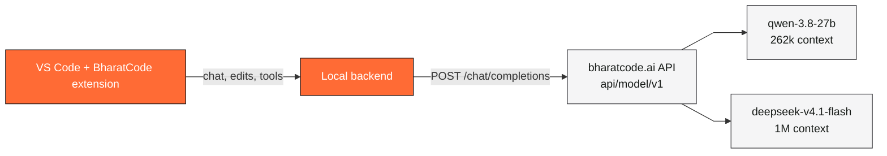

<p align="center">
  <a href="https://bharatcode.ai"></a>
</p>

# BharatCode

<p align="center">
  The open source AI coding agent for VS Code, powered by bharatcode.ai.
</p>

<p align="center">
  <a href="https://github.com/thenabbu/BharatCode-VSCode-Extension/releases/latest"></a>
  <a href="https://github.com/thenabbu/BharatCode-VSCode-Extension/blob/bc/main/LICENSE"></a>
  <a href="https://bharatcode.ai"></a>
</p>

BharatCode is an AI coding agent that meets you where you work — in VS Code. It's open source and MIT licensed. You pick from two models — `qwen-3.8-27b` (262k context) and `deepseek-v4.1-flash` (1M context) — through a single API key from [bharatcode.ai](https://bharatcode.ai), and every request goes through the BharatCode API at `https://bharatcode.ai/api/model/v1`.



## Installation

The extension ships as a platform VSIX from the [Releases page](https://github.com/thenabbu/BharatCode-VSCode-Extension/releases/latest) (a VS Code Marketplace listing is planned):

```bash
code --install-extension kilo-vscode-win32-x64.vsix   # Windows
code --install-extension kilo-vscode-linux-x64.vsix   # Linux
```

Or drop the `.vsix` file into VS Code's `Extensions: Install from VSIX...` command.

On first launch, BharatCode prompts you for an API key — create one at [bharatcode.ai](https://bharatcode.ai). That's the whole setup.

## Configuration

Everything user-configurable lives in one guide: [docs/CONFIGURATION.md](docs/CONFIGURATION.md) — API key, models, default model selection, config files, and how to get inline autocomplete working with a bring-your-own-key provider.

Quick answers:

- Change your API key: Command Palette → `BharatCode: Set API Key`
- Switch models mid-task from the model picker in the chat header
- The key is stored by the extension backend, never in your `settings.json`

## Agents

BharatCode ships with specialized agents you switch between depending on the task. You can also build your own custom agents.

- **Code** — the default. Implements and edits code from natural language.
- **Plan** — designs architecture and writes implementation plans before any code gets written.
- **Ask** — answers questions about your codebase without touching any files.
- **Debug** — troubleshoots and traces issues.

## What it does

- **Code generation** from natural language, across multiple files.
- **Inline autocomplete** with ghost-text suggestions and tab to accept — served by a bring-your-own-key provider (BharatCode's two models are chat-only; see [configuration](docs/CONFIGURATION.md#inline-autocomplete)).
- **Self-checking** so the agent reviews and corrects its own work.
- **Terminal and browser control** to run commands and automate the web.
- **Skills, modes, and MCP servers** defined in plain text to shape the agent per project.
- **Two models** with mid-task switching — `qwen-3.8-27b` (262k context) and `deepseek-v4.1-flash` (1M context) — so you can match latency and reasoning to the job.

## Contributing

Contributions are welcome from developers, writers, and everyone in between. Start with the [Contributing Guide](CONTRIBUTING.md) for environment setup, coding standards, and how to open a pull request. See [RELEASING.md](RELEASING.md) for the VS Code extension release process.

Please review our [Code of Conduct](CODE_OF_CONDUCT.md) before getting involved.

## License

MIT. You're free to use, modify, and distribute this code, including commercially, as long as you keep the attribution and license notices. See [LICENSE](LICENSE).

## FAQ

<details>
<summary>Where does BharatCode come from?</summary>

BharatCode is a fork of [Kilo Code](https://github.com/Kilo-Org/kilocode), which is itself a fork of [OpenCode](https://github.com/anomalyco/opencode). It is rebranded and reconfigured for the bharatcode.ai provider.

</details>

---

**Repository** [GitHub](https://github.com/thenabbu/BharatCode-VSCode-Extension) · [bharatcode.ai](https://bharatcode.ai)
