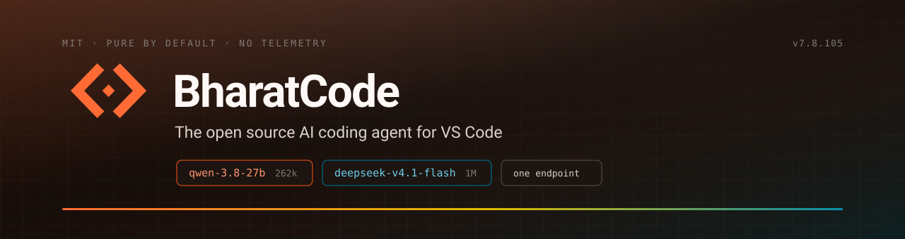

<div align="center">



<br>

<a href="https://marketplace.visualstudio.com/items?itemName=thenabbu.bharatcode-vscode"></a>
<a href="https://marketplace.visualstudio.com/items?itemName=thenabbu.bharatcode-vscode"></a>
<a href="https://github.com/thenabbu/BharatCode-VSCode-Extension/releases/latest"></a>
<a href="https://github.com/thenabbu/BharatCode-VSCode-Extension/actions/workflows/checks.yml"></a>
<a href="LICENSE"></a>
<a href="https://bharatcode.ai"></a>

</div>

> **Fork notice.** BharatCode is a fork of [Kilo Code](https://github.com/Kilo-Org/kilocode), itself a fork of [OpenCode](https://github.com/anomalyco/opencode). Upstream projects and their contributors did the heavy lifting — this fork exists to bring their agent to the [BharatCode](https://bharatcode.ai) platform, rebranded and reconfigured so that bharatcode.ai is the only provider wired in. All credit to them; MIT licensed, attribution preserved in [LICENSE](LICENSE) and in the `kilocode_change` markers throughout the source. We do not claim their work as ours.

## What this is

An AI coding agent that runs inside VS Code — not beside it. It reads your project, edits files across it, runs terminal commands, and drives a browser to check its own work. Open source, MIT, and honest about its limits: two chat models from one key, and inline autocomplete that needs a bring-your-own-key provider.

Everything below is what the shipped build actually does. If a feature isn't listed here, it isn't in this fork, even though you may have read about it somewhere upstream.

## Install

The extension is listed on the VS Code Marketplace as **`thenabbu.bharatcode-vscode`**.

```text
Ctrl+P  →  ext install thenabbu.bharatcode-vscode
```

Or search for **BharatCode** in the Extensions view. Needs VS Code **1.105.1** or newer.

Need to install by hand instead? Download the file for your system from the [Releases page](https://github.com/thenabbu/BharatCode-VSCode-Extension/releases/latest), then run `Extensions: Install from VSIX...` from the Command Palette — or point `code` at it directly, swapping the name for your platform from the table below:

```bash
code --install-extension bharatcode-vscode-linux-x64-7.8.105.vsix
```

Releases publish **eight** platform builds — Windows, Linux, macOS and Alpine, each on x64 and arm64 — plus a `SHA256SUMS` file:

| Platform | File suffix | | Platform | File suffix |
|---|---|---|---|---|
| Linux x64 | `linux-x64` | | Linux arm64 | `linux-arm64` |
| Alpine x64 | `alpine-x64` | | Alpine arm64 | `alpine-arm64` |
| macOS Intel | `darwin-x64` | | macOS Apple Silicon | `darwin-arm64` |
| Windows x64 | `win32-x64` | | Windows arm64 | `win32-arm64` |

Each build is about 160–180 MB because it carries its own backend binary. That is the reason for the split: you download one platform, never all of them. Verify a download against `SHA256SUMS` with `sha256sum --check`.

> **macOS Gatekeeper:** builds are unsigned for now. If macOS blocks the install: `xattr -dr com.apple.quarantine ~/.vscode/extensions/bharatcode.bharatcode-vscode-*`

Then: create a key at [bharatcode.ai](https://bharatcode.ai), paste it when BharatCode asks on first launch, and start a task. That is the whole onboarding — there is no second account, no sign-up flow inside the editor, no CLI to install.

## The two models

One endpoint, one key, two models with genuinely different jobs:

| Model | Context | Reach for it when |
|---|---|---|
| `qwen-3.8-27b` | 262k | Everyday edits, fast turnaround, most tasks |
| `deepseek-v4.1-flash` | 1M | Whole-repo reasoning, long sessions, large files |

Switch mid-task from the model picker in the chat header. Both are served from `https://bharatcode.ai/api/model/v1`.

**The honest part:** these two models are **chat-only**. There is no fill-in-the-middle endpoint, so they cannot power ghost-text autocomplete. Inline autocomplete in this build works only if you connect your own completion provider — Mistral or Inception — through the Providers page. See [Configuration](docs/CONFIGURATION.md#inline-autocomplete). Bracketed autocomplete on a BharatCode key alone does not exist, and no page in this repo will tell you otherwise.

## How a prompt travels


The extension is not a thin API wrapper. It ships a complete agent runtime inside the VSIX:

1. **Bundled backend binary.** `extension/bin/bharatcode` (`bharatcode.exe` on Windows) travels inside every platform build. A system-installed CLI is never used, so the version you get is the version that was tested with that extension release.
2. **Lazy local server.** On first use the extension's `ServerManager` spawns `bharatcode serve --port 0`. The OS picks a free port; the extension parses it from the child's stdout. That one child is reused until it exits — if it dies, the status chip in the chat header offers **Restart server**.
3. **Loopback-only auth.** The server binds `127.0.0.1` and is guarded by HTTP Basic auth with a random 32-byte per-session password passed as `KILO_SERVER_PASSWORD`. Nothing on your network reaches it without that password.
4. **The request path.** The chat UI is a SolidJS webview talking to the extension host over `postMessage`. The host speaks HTTP + server-sent events to the local backend via `@kilocode/sdk`. The backend calls bharatcode.ai.

Your API key lives in the extension backend's auth store — never in `settings.json` — and is sent only to the provider you connected. [PRIVACY.md](PRIVACY.md) has the full inventory.

## What it does

- **Multi-file code generation** from natural language, applied as real edits you review as a diff.
- **Self-checking** — the agent re-reads its own output and corrects before handing back.
- **Terminal and browser control**, so it can run the thing it just wrote and look at the result.
- **Agents** you switch between by intent: **Code** (default, implements), **Plan** (designs before writing), **Ask** (answers without touching files), **Debug** (traces failures). Custom agents are plain-text definitions of your own.
- **Agent Manager** — several sessions side by side in one editor tab, each isolated in its own git worktree, so parallel work cannot collide. Command Palette → `BharatCode: Agent Manager`.
- **MCP servers, skills and rules** defined in plain text, shaped per project.
- **Generated commit messages** from your actual diff (`BharatCode: Generate Commit Message`).
- **Inline actions** on any selection: explain, fix, improve, add to context.
- **Autocomplete** — ghost text and next-edit suggestions, via your own BYOK provider (see above).

Seventy-four commands ship in the palette. The ones worth knowing on day one:

| Command | What it does |
|---|---|
| `BharatCode: New Task` | Start a fresh session |
| `BharatCode: Agent Manager` | Multi-session, worktree-isolated workspace |
| `BharatCode: Connect Account` | Set or replace your API key |
| `BharatCode: Reload Config and Skills` | Re-read config after edits |
| `BharatCode: Toggle Auto-Approve` | Flip approval mode for the session |
| `BharatCode: Generate Commit Message` | Write a message from the staged diff |

## Configuration

Two layers, deliberately separate:

- **VS Code settings** (`kilo-code.*` — the stable id namespace, kept for compatibility) control UI and editor behaviour: font size, language, notifications, default model, auto-approve. Forty contributed settings, documented inline in the Settings UI.
- **Agent runtime config** lives in `kilo.json` — project-level, or global at `~/.config/kilo/`. Model, permissions, instructions, MCP servers, custom agents.

The `kilo-code.*` prefix in setting ids and the `.kilo` config path are intentional: they are identifiers the backend reads, and renaming them would break your keybindings and existing config. Only the human-readable labels say BharatCode.

Every setting, config file and troubleshooting case is in **[docs/CONFIGURATION.md](docs/CONFIGURATION.md)**.

## What this build switches off

Upstream couples the agent to its own cloud. This fork removes that coupling rather than hiding it:

- **No telemetry**, no session sharing, no presence.
- **No model-catalogue fetch** from upstream. The provider list is bharatcode.ai plus any BYOK key you add.
- **No sign-in to a second service.** Your API key is the whole identity.

Only `bharatcode.ai` is contacted (plus whichever BYOK provider you configure yourself). Details and reasons: [PRIVACY.md](PRIVACY.md).

## Build it yourself

Everything runs on [Bun](https://bun.sh). From the repo root:

```bash
bun install
bun run extension           # build + launch VS Code with the extension in dev mode
bun run extension:isolated  # same, in a clean profile under .kilo-dev/
```

Per-package commands, guards and quality gates are in **[AGENTS.md](AGENTS.md)** — the file both contributors and the agent itself read.

Building a `.vsix` for a single platform:

```bash
cd packages/kilo-vscode
bun run package
```

The full eight-platform release chain is automated — every push to `bc/main` derives the next version, builds all eight targets, audits the archives and publishes a GitHub Release. See **[RELEASING.md](RELEASING.md)**.

## Where to look next

| If you want to… | Read |
|---|---|
| Change a setting, pick a model, get autocomplete working | [docs/CONFIGURATION.md](docs/CONFIGURATION.md) |
| Work on the code, run the gates | [AGENTS.md](AGENTS.md) |
| Open your first pull request | [CONTRIBUTING.md](CONTRIBUTING.md) |
| Exercise the backend without rebuilding the extension | [TESTING.md](TESTING.md) |
| Review someone else's PR | [REVIEW.md](REVIEW.md) |
| Cut a release | [RELEASING.md](RELEASING.md) |
| Know exactly what is sent where | [PRIVACY.md](PRIVACY.md) |
| Report a vulnerability | [SECURITY.md](SECURITY.md) |

## FAQ

<details>
<summary>Is this just Kilo Code with a new name?</summary>

No. The rebrand is one part of it — the harder part is what was removed. The upstream cloud coupling (telemetry, session sharing, presence, the internal marketplace, upstream's model catalogue) is stripped, and the provider layer is reconfigured so bharatcode.ai is the only wired-in provider. Everything else is upstream engineering we depend on and credit.
</details>

<details>
<summary>Why two models and not five hundred?</summary>

Because the provider serves two. BharatCode is built to make one provider's setup effortless in VS Code, not to be a universal router. If you want a broad model catalogue, upstream Kilo Code or any multi-provider extension is a better fit and we would rather say so than pad a feature list.
</details>

<details>
<summary>Why does autocomplete ask for a different key?</summary>

The BharatCode models answer chat completions only; fill-in-the-middle is a separate endpoint class that they do not expose. Ghost-text needs a completion model, so autocomplete uses your own Mistral or Inception key. Your BharatCode key still covers all chat, editing and agent work.
</details>

<details>
<summary>Why is the download so large?</summary>

Each platform build carries its own ~150 MB agent runtime binary, so the extension works with nothing installed on your `PATH`. Splitting per platform means you fetch only yours — one 180 MB file instead of a 1.07 GB universal one.
</details>

<details>
<summary>Does it work offline?</summary>

No. The agent runtime is local, but every model call goes to bharatcode.ai.
</details>

## Contributing

Pull requests are welcome from developers and writers alike. Start with [CONTRIBUTING.md](CONTRIBUTING.md) for setup and standards, and read [AGENTS.md](AGENTS.md) before touching code — it is the same file the agent itself follows. Please read the [Code of Conduct](CODE_OF_CONDUCT.md) first.

## License

MIT. Use it, modify it, ship it commercially — keep the attribution and licence notices. The full text, including upstream copyright lines, is in [LICENSE](LICENSE).

<div align="center">
<br>
<sub><a href="https://bharatcode.ai">bharatcode.ai</a> · <a href="https://marketplace.visualstudio.com/items?itemName=thenabbu.bharatcode-vscode">Marketplace</a> · <a href="https://github.com/thenabbu/BharatCode-VSCode-Extension/releases/latest">Releases</a> · <a href="https://github.com/thenabbu/BharatCode-VSCode-Extension/issues">Issues</a></sub>
</div>
