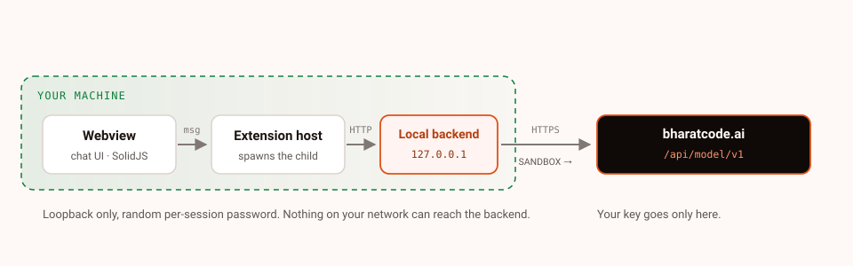

<div align="center">


<br>

<a href="https://marketplace.visualstudio.com/items?itemName=thenabbu.bharatcode-vscode"></a>
<a href="https://github.com/thenabbu/BharatCode-VSCode-Extension/releases/latest"></a>
<a href="https://github.com/thenabbu/BharatCode-VSCode-Extension/actions/workflows/checks.yml"></a>
<a href="LICENSE"></a>
<a href="https://bharatcode.ai"></a>

</div>

<p align="center"><strong>An agent inside VS Code, running on your BharatCode models.</strong><br>Install it, sign in, and it is working — no base URL, no provider JSON, no model list, no CLI, no second account.</p>

## What this is

Two products, and it is worth being precise about which one you are looking at:

- **[BharatCode](https://bharatcode.ai) is an LLM inference provider.** One OpenAI-compatible endpoint, one key, two chat models. It serves models — it is not an agent, and it does not run anything in your editor.
- **This extension is the VS Code client for that provider.** It is the half that turns those models into a working agent, and the reason the setup is one step instead of ten.

The extension ships the agent runtime inside the VSIX and configures the provider for you: no base URL to paste, no custom-provider block to write, no model list to maintain, no separate CLI to install alongside. Those four things are the whole point of this package, and they are the only reason it exists rather than a "paste your endpoint here" wrapper.

Everything below describes the shipped build. If a feature is not listed here, it is not in this fork — however much you may have read about it upstream.

> **Fork notice.** This extension is a fork of [Kilo Code](https://github.com/Kilo-Org/kilocode), itself a fork of [OpenCode](https://github.com/anomalyco/opencode). Upstream projects and their contributors did the heavy lifting — this fork exists to bring their agent to the [BharatCode](https://bharatcode.ai) provider, rebranded and reconfigured so that bharatcode.ai is the only provider wired in. All credit to them; MIT licensed, attribution preserved in [LICENSE](LICENSE) and in the `kilocode_change` markers throughout the source. We do not claim their work as ours.

## Get started

1. **Install the extension.** It is listed on the VS Code Marketplace as `thenabbu.bharatcode-vscode`. From the Command Palette: `Ctrl+P`, then `ext install thenabbu.bharatcode-vscode`. Or search for **BharatCode** in the Extensions view. Requires VS Code **1.105.1** or newer.
2. **Open a folder.** `File → Open Folder`. The agent runtime works against a workspace root, and sign-in starts from it, so an empty window cannot connect.
3. **Connect your account.** BharatCode asks on first launch and offers two paths — **Sign in with BharatCode** (opens your browser, nothing to copy, recommended) or **paste an API key** from your bharatcode.ai account. Either one works; the credential is stored by the extension backend, never in `settings.json`.

Dismissed the prompt, or moving to another machine? Run **`BharatCode: Connect Account`** from the Command Palette. That is the whole onboarding — there is no second account, no sign-up flow inside the editor, no CLI to install by hand.

## What you get

- **Code generation across files**, applied as real edits you review as a diff.
- **Agents you switch between by intent** — **Code** implements, **Plan** designs before writing, **Ask** answers without touching files, **Debug** traces failures. Custom agents are plain-text definitions of your own.
- **Agent Manager** — several sessions side by side, each isolated in its own git worktree, so parallel work cannot collide.
- **Terminal and browser control**, so the agent can run what it just wrote and look at the result.
- **Self-checking** — it re-reads its own output and corrects before handing back.
- **MCP servers, skills and rules** in plain text, shaped per project.
- **Generated commit messages** from your actual staged diff.
- **Inline actions** on any selection: explain, fix, improve, add to context.

Thirty-five settings and seventy commands ship in the palette; the six worth knowing on day one are
`BharatCode: New Task`, `BharatCode: Connect Account`, `BharatCode: Agent Manager`,
`BharatCode: Toggle Auto-Approve`, `BharatCode: Generate Commit Message` and
`BharatCode: Reload Config and Skills`.

## How a prompt travels



The extension is not a thin API wrapper. It ships a complete agent runtime inside the package:

1. **Bundled backend binary.** `extension/bin/bharatcode` (`bharatcode.exe` on Windows) travels inside every platform build. A system-installed CLI is never used, so the runtime you get is the one that was tested with that extension release.
2. **Lazy local server.** On first use the extension's `ServerManager` spawns `bharatcode serve --port 0`. The OS picks a free port and the extension reads it from the child's stdout. That one child is reused until it exits; if it dies, the status chip in the chat header offers **Restart server**.
3. **Loopback-only auth.** The server binds `127.0.0.1` and is guarded by HTTP Basic auth with a random 32-byte per-session password passed as `KILO_SERVER_PASSWORD`. The child also watches the extension host's PID and exits if the host is killed without cleaning up. Nothing on your network reaches it without that password.
4. **The request path.** The chat UI is a SolidJS webview talking to the extension host over `postMessage`. The host speaks HTTP and server-sent events to the local backend through `@kilocode/sdk`. The backend calls bharatcode.ai.

That architecture is also why the download is 160–180 MB: the runtime is inside the package, so nothing has to be on your `PATH`.

## The two models

One endpoint, one key, two models with genuinely different jobs:

| Model | Context | Reach for it when |
|---|---|---|
| `qwen-3.8-27b` | 262k | Everyday edits, fast turnaround, most tasks |
| `deepseek-v4.1-flash` | 1M | Whole-repo reasoning, long sessions, large files |

Both are served from `https://bharatcode.ai/api/model/v1`, and the list is read from that endpoint rather than from a hardcoded catalogue. Switch mid-task from the model picker in the chat header.

## Configuration

Two layers, deliberately separate:

- **VS Code settings** (`kilo-code.*`) control the editor side: font size, language, notifications, default model, auto-approve. Thirty-five settings are contributed, documented inline in the Settings UI.
- **Agent runtime config** lives in `kilo.json` — project-level, or global at `~/.config/kilo/`. Model, permissions, instructions, MCP servers, custom agents.

The `kilo-code.*` prefix on setting ids and the `.kilo` config path are intentional: they are identifiers the backend reads, and renaming them would break your keybindings and existing config. Only the human-readable labels say BharatCode.

Every setting, config file and troubleshooting case is in **[docs/CONFIGURATION.md](docs/CONFIGURATION.md)**.

## What this build does not do

- **No inline autocomplete.** BharatCode's models are chat-only — there is no fill-in-the-middle endpoint — so there is no ghost-text completion in this build. VS Code's own suggestions keep working alongside the agent, and the two do not conflict.
- **No telemetry, no session sharing, no presence.** Upstream couples the agent to its own cloud; this fork removes the coupling rather than hiding it.
- **No 500-model catalogue.** One provider, two models, and we would rather say so than pad a feature list. If you want a broad model catalogue, upstream Kilo Code or a multi-provider extension is a better fit.
- **No second sign-in.** Your BharatCode credential is the whole identity. Only bharatcode.ai is contacted, plus any BYOK provider you configure yourself.

The full inventory of what leaves your machine is in **[PRIVACY.md](PRIVACY.md)**.

## Install by hand

<details>
<summary>Download a <code>.vsix</code> instead of using the Marketplace</summary>

<br>

Grab the file for your system from the [Releases page](https://github.com/thenabbu/BharatCode-VSCode-Extension/releases/latest), then run `Extensions: Install from VSIX...` from the Command Palette — or point the `code` CLI at it:

```bash
code --install-extension bharatcode-vscode-linux-x64-<version>.vsix
```

Releases publish **eight** platform builds — Windows, Linux, macOS and Alpine, each on x64 and arm64 — plus a `SHA256SUMS` file:

| Platform | File suffix | | Platform | File suffix |
|---|---|---|---|---|
| Linux x64 | `linux-x64` | | Linux arm64 | `linux-arm64` |
| Alpine x64 | `alpine-x64` | | Alpine arm64 | `alpine-arm64` |
| macOS Intel | `darwin-x64` | | macOS Apple Silicon | `darwin-arm64` |
| Windows x64 | `win32-x64` | | Windows arm64 | `win32-arm64` |

Each build is 160–180 MB because it carries its own runtime binary. That is the reason for the split: you download one platform, never all of them. Verify a download against `SHA256SUMS` with `sha256sum --check`.

> **macOS Gatekeeper:** builds are unsigned for now. If macOS blocks the install: `xattr -dr com.apple.quarantine ~/.vscode/extensions/bharatcode.bharatcode-vscode-*`

</details>

## Build it yourself

Everything runs on [Bun](https://bun.sh). From the repo root:

```bash
bun install
bun run extension           # build + launch VS Code with the extension in dev mode
bun run extension:isolated  # same, in a clean profile under .kilo-dev/
```

Building a `.vsix` for a single platform:

```bash
cd packages/kilo-vscode
bun run package
```

Per-package commands, guards and quality gates are in **[AGENTS.md](AGENTS.md)** — the file both contributors and the agent itself read. The eight-platform release chain is automated: every push to `bc/main` derives the next version, builds all eight targets, audits the archives and publishes a GitHub Release. See **[RELEASING.md](RELEASING.md)**.

## FAQ

<details>
<summary>Is BharatCode an agent?</summary>

No. BharatCode is an LLM inference provider — an OpenAI-compatible endpoint with two chat models. This extension is what gives you an agent: it ships the runtime and points it at your BharatCode account. When someone says "the BharatCode extension", they mean this package; when they say "BharatCode", they mean the provider behind it.
</details>

<details>
<summary>Do I need an API key if I sign in with the browser?</summary>

No. Sign-in and API key are two ways in to the same thing, and you only need one. Browser sign-in stores a session; a pasted key stores a key. Both live in the extension backend's auth store, never in `settings.json`, and both are sent only to the provider you connected.
</details>

<details>
<summary>Is this just Kilo Code with a new name?</summary>

No. The rebrand is the smaller part. The upstream cloud coupling (telemetry, session sharing, presence, the internal marketplace, upstream's model catalogue) is stripped, the provider layer is reconfigured so bharatcode.ai is the only provider wired in, and the inline autocomplete feature is removed entirely because BharatCode's models cannot support it. Everything else is upstream engineering we depend on and credit.
</details>

<details>
<details>
<details>
<summary>How do I sign out, or start over on a new account?</summary>

Sign out from **BharatCode: Settings → Providers → the BharatCode card → disconnect**. That removes the stored credential and the provider config, so a stale key cannot silently reconnect. Uninstalling the extension does *not* log you out: the credential files live outside the extension folder, so a reinstall resumes the old session. For a full reset, quit VS Code completely first, then delete `~/.local/share/kilo/` (`%USERPROFILE%\.local\share\kilo\` on Windows).
</details>

<details>
<summary>Does it work offline?</summary>

No. The agent runtime is local, but every model call goes to bharatcode.ai.
</details>

## Where to look next

| If you want to… | Read |
|---|---|
| Change a setting or pick a model | [docs/CONFIGURATION.md](docs/CONFIGURATION.md) |
| Work on the code, run the gates | [AGENTS.md](AGENTS.md) |
| Open your first pull request | [CONTRIBUTING.md](CONTRIBUTING.md) |
| Exercise the backend without rebuilding the extension | [TESTING.md](TESTING.md) |
| Review someone else's PR | [REVIEW.md](REVIEW.md) |
| Cut a release | [RELEASING.md](RELEASING.md) |
| Know exactly what is sent where | [PRIVACY.md](PRIVACY.md) |
| Report a vulnerability | [SECURITY.md](SECURITY.md) |

## Contributing

Pull requests are welcome from developers and writers alike. Start with [CONTRIBUTING.md](CONTRIBUTING.md) for setup and standards, and read [AGENTS.md](AGENTS.md) before touching code — it is the same file the agent itself follows. Please read the [Code of Conduct](CODE_OF_CONDUCT.md) first.

## License

MIT. Use it, modify it, ship it commercially — keep the attribution and licence notices. The full text, including upstream copyright lines, is in [LICENSE](LICENSE).

<div align="center">
<br>
<sub><a href="https://bharatcode.ai">bharatcode.ai</a> · <a href="https://marketplace.visualstudio.com/items?itemName=thenabbu.bharatcode-vscode">Marketplace</a> · <a href="https://github.com/thenabbu/BharatCode-VSCode-Extension/releases/latest">Releases</a> · <a href="https://github.com/thenabbu/BharatCode-VSCode-Extension/issues">Issues</a></sub>
</div>
