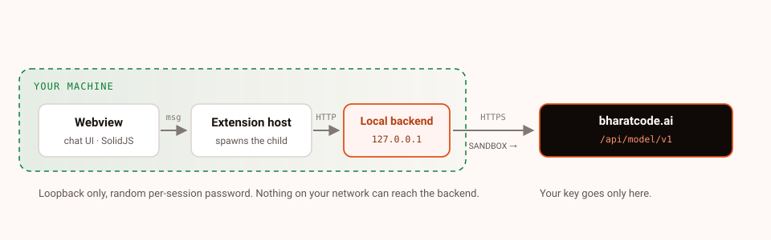

<p align="center">
  <a href="https://bharatcode.ai"></a>
</p>

# BharatCode

<p align="center">
  The open source AI coding agent for VS Code, powered by bharatcode.ai.
</p>

<p align="center">
  <a href="https://github.com/thenabbu/BharatCode-VSCode-Extension/releases/latest"></a>
  <a href="https://github.com/thenabbu/BharatCode-VSCode-Extension/blob/bc/main/LICENSE"></a>
  <a href="https://bharatcode.ai"></a>
</p>

BharatCode is an AI coding agent that meets you where you work — in VS Code. It's open source and MIT licensed.

> **Fork notice:** BharatCode is a fork of [Kilo Code](https://github.com/Kilo-Org/kilocode) (itself a fork of [OpenCode](https://github.com/anomalyco/opencode)), rebranded and reconfigured for the [bharatcode.ai](https://bharatcode.ai) provider. The upstream projects and their contributors did the heavy lifting — this fork exists to bring their agent to the BharatCode platform. All credit to them; MIT licensed, attribution preserved. You pick from two models — `qwen-3.8-27b` (262k context) and `deepseek-v4.1-flash` (1M context) — through a single API key from [bharatcode.ai](https://bharatcode.ai), and every request goes through the BharatCode API at `https://bharatcode.ai/api/model/v1`.

## Why BharatCode

BharatCode exists to make the [bharatcode.ai](https://bharatcode.ai) setup effortless in VS Code. There is nothing to configure before you start:

1. Install the `.vsix` from the [Releases page](https://github.com/thenabbu/BharatCode-VSCode-Extension/releases/latest).
2. Paste your API key when prompted on first launch.
3. Chat.

That is the whole setup. What you get behind those three steps:

- **Two models, one endpoint.** `qwen-3.8-27b` (262k context) and `deepseek-v4.1-flash` (1M context) both come through one OpenAI-compatible endpoint at `https://bharatcode.ai/api/model/v1` — switch mid-task from the model picker, no other provider accounts needed.
- **No account juggling.** One API key from [bharatcode.ai](https://bharatcode.ai); no separate gateway sign-in, no Kilo account or login flow — the cloud coupling from the upstream fork is stripped out of this build.
- **No system-wide CLI to install.** The extension carries its own backend binary (see [How it works](#how-it-works)); nothing to put on your `PATH`.
- **Your key stays local.** It lives in the extension backend's auth store, never in `settings.json`, and is only sent to the provider (see [PRIVACY.md](PRIVACY.md)).

## How it works

The extension is not a thin API client. It runs a complete agent stack locally inside VS Code:

- **Bundled backend binary.** The extension ships its own `bharatcode` binary (`extension/bin/bharatcode`, `.exe` on Windows) inside the VSIX. It never calls a system-installed CLI.
- **Lazy local server.** On first use — your first chat submit, opening the Agent Manager, or an autocomplete prewarm — the extension's `ServerManager` spawns `bharatcode serve --port 0`. The OS picks a free port and the extension parses it from the child's stdout. That one child process is reused until it exits; if it crashes, the status chip in the chat header offers **Restart server**.
- **Loopback-only auth.** The server listens on `127.0.0.1` only and is protected by HTTP Basic auth with a random per-session password (32-byte hex) injected as `KILO_SERVER_PASSWORD`; the username is `kilo`. Nothing on your network can reach it without that password.
- **Request path.** The chat UI is a SolidJS webview that talks to the extension host over `postMessage`. The extension host calls the local backend over HTTP with server-sent events for streaming responses, using `@kilocode/sdk`. The backend forwards to the BharatCode API.

```text
VS Code webview (SolidJS)
        │  postMessage
        ▼
Extension host
        │  HTTP + SSE (Basic auth, 127.0.0.1)
        ▼
Local backend  —  `bharatcode serve --port 0`  (bundled binary)
        │  HTTPS
        ▼
https://bharatcode.ai/api/model/v1
        ├── qwen-3.8-27b      (262k context)
        └── deepseek-v4.1-flash  (1M context)
```



**Configuration is split in two places.** VS Code settings (`kilo-code.*`) control UI and editor behaviour — themes, keybindings, display options. Agent runtime behaviour — model, permissions, instructions — lives in project and global agent config (`kilo.json`, `~/.config/kilo/`). Both are covered in one guide: [docs/CONFIGURATION.md](docs/CONFIGURATION.md).

## Installation

The extension ships as a platform VSIX from the [Releases page](https://github.com/thenabbu/BharatCode-VSCode-Extension/releases/latest) (a VS Code Marketplace listing is planned):

```bash
code --install-extension bharatcode-vscode-win32-x64.vsix   # Windows
code --install-extension bharatcode-vscode-linux-x64.vsix   # Linux
```

Or drop the `.vsix` file into VS Code's `Extensions: Install from VSIX...` command. Releases cover Windows, Linux, macOS, and Alpine on x64 and arm64.

On first launch, BharatCode prompts you for an API key — create one at [bharatcode.ai](https://bharatcode.ai). That's the whole setup.

## Configuration

Everything user-configurable lives in one guide: [docs/CONFIGURATION.md](docs/CONFIGURATION.md) — API key, models, default model selection, config files, and how to get inline autocomplete working with a bring-your-own-key provider.

Quick answers:

- Change your API key: Command Palette → `BharatCode: Set API Key`
- Switch models mid-task from the model picker in the chat header
- The key is stored by the extension backend, never in your `settings.json`

## Agents

BharatCode ships with specialized agents you switch between depending on the task. You can also build your own custom agents.

- **Code** — the default. Implements and edits code from natural language.
- **Plan** — designs architecture and writes implementation plans before any code gets written.
- **Ask** — answers questions about your codebase without touching any files.
- **Debug** — troubleshoots and traces issues.

## What it does

- **Code generation** from natural language, across multiple files.
- **Inline autocomplete** with ghost-text suggestions and tab to accept — served by a bring-your-own-key provider (BharatCode's two models are chat-only; see [configuration](docs/CONFIGURATION.md#inline-autocomplete)).
- **Self-checking** so the agent reviews and corrects its own work.
- **Terminal and browser control** to run commands and automate the web.
- **Skills, modes, and MCP servers** defined in plain text to shape the agent per project.
- **Two models** with mid-task switching — `qwen-3.8-27b` (262k context) and `deepseek-v4.1-flash` (1M context) — so you can match latency and reasoning to the job.
- **Agent Manager** — multi-agent sessions in an editor tab (Command Palette → `Agent Manager`), with each session isolated in its own git worktree.

## Contributing

Contributions are welcome from developers, writers, and everyone in between. Start with the [Contributing Guide](CONTRIBUTING.md) for environment setup, coding standards, and how to open a pull request. See [RELEASING.md](RELEASING.md) for the VS Code extension release process.

Please review our [Code of Conduct](CODE_OF_CONDUCT.md) before getting involved.

## License

MIT. You're free to use, modify, and distribute this code, including commercially, as long as you keep the attribution and license notices. See [LICENSE](LICENSE).

## Repository documentation

Where to go next, depending on what you need:

| Document | Covers |
|---|---|
| [README.md](README.md) | What the extension is, how it works, how to install it (this file). |
| [AGENTS.md](AGENTS.md) | Repo-wide rules for agents and humans working on this codebase: build, dev, and test commands. |
| [CONTRIBUTING.md](CONTRIBUTING.md) | Prerequisites, environment setup, coding standards, and how to open a pull request. |
| [TESTING.md](TESTING.md) | Spinning up a local backend and exercising it with `curl`/`fetch` without rebuilding the extension. |
| [REVIEW.md](REVIEW.md) | What reviewers look for on pull requests — human or agent. |
| [RELEASING.md](RELEASING.md) | The release process: version bump, per-platform VSIX builds, checksums, tagging. |
| [PRIVACY.md](PRIVACY.md) | What data the extension collects and sends, including how the API key is stored. |
| [SECURITY.md](SECURITY.md) | How to report vulnerabilities in this repository. |
| [docs/CONFIGURATION.md](docs/CONFIGURATION.md) | The full user configuration guide: key, models, config files, autocomplete. |

## FAQ

<details>
<summary>Where does BharatCode come from?</summary>

BharatCode is a fork of [Kilo Code](https://github.com/Kilo-Org/kilocode) (v7.8.8), which is itself a fork of [OpenCode](https://github.com/anomalyco/opencode) — see the fork notice at the top. Upstream history, commit links, and the `kilocode_change` markers in the source preserve full attribution.

</details>

---

**Repository** [GitHub](https://github.com/thenabbu/BharatCode-VSCode-Extension) · [bharatcode.ai](https://bharatcode.ai)
